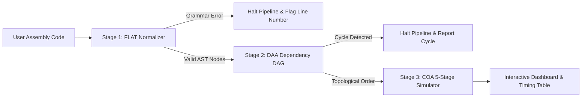

# AssemblyFlow

> **Automated Assembly Code Normalizer & Pipelined Execution Analyzer**

AssemblyFlow is an academic engineering computer science project that normalizes assembly language instructions, extracts data dependencies, and simulates/analyzes 5-stage RISC pipelined execution stages and hazard resolutions.

Current repository status: **Step 7: Complete Testing and Debugging of AssemblyFlow** completed. All core modules (FLAT, DAA, COA), their respective endpoints, cross-stage invariants, and the full end-to-end user workflow have been rigorously tested, verified, and debugged with 67 passing automated tests and clean production builds.

---

## 🛠️ Technology Stack

- **Frontend**: React 19, TypeScript, Vite, Clean developer-tool CSS
- **Backend**: Node.js, Express.js, TypeScript (`tsx` runner & Node test runner)
- **Communication**: REST API (with Vite proxy routing `/api` to port 5000)
- **Database**: None required

---

## 🔄 The Complete Integrated Workflow (FLAT → DAA → COA)

AssemblyFlow executes an integrated three-stage analysis pipeline for educational assembly code:



1. **Stage 1 — FLAT (Formal Languages & Automata Theory)**:
   - Lexical scanner breaks raw assembly text into categorized tokens: opcodes, registers, immediate integers, and commas.
   - Evaluates statements against the formal assembly grammar:
     - `LOAD destinationRegister, integer`
     - `MOV destinationRegister, sourceRegister`
     - `ADD destinationRegister, sourceRegister1, sourceRegister2`
     - `SUB destinationRegister, sourceRegister1, sourceRegister2`
   - Validates registers `R0`–`R15` via a deterministic finite automaton (DFA).
   - **Safety Halt**: If syntax or semantic errors are found, the workflow safely halts immediately. Stages DAA and COA are never executed on malformed code.

2. **Stage 2 — DAA (Design & Analysis of Algorithms)**:
   - Computes Read Sets $R(I)$ and Write Sets $W(I)$ for all validated instructions.
   - Computes Bernstein's conditions to identify:
     - **RAW** (Read-After-Write / True data dependency)
     - **WAR** (Write-After-Read / Anti-dependency)
     - **WAW** (Write-After-Write / Output dependency)
   - Builds a Directed Acyclic Graph (DAG) with consolidated multi-hazard edges.
   - Executes **Kahn's Topological Sort** ($\mathcal{O}(V + E)$) with deterministic tie-breaking (original program order).

3. **Stage 3 — COA (Computer Organization & Architecture)**:
   - Simulates execution across the classic five-stage RISC pipeline: **IF → ID → EX → MEM → WB**.
   - Assumes a split-phase register file (write first half of cycle, read second half).
   - Injects stall bubbles (NOP cycles) for unresolved RAW hazards in the ID stage.
   - Supports live toggle for **Data Forwarding** (ALU-to-ALU bypassing) to eliminate stall bubbles.
   - Generates the discrete clock-cycle timing matrix and computes realistic **Cycles Per Instruction (CPI)** and speedup.

---

## 📁 Project Structure

```text
assemblyflow/
├── backend/
│   ├── src/
│   │   ├── controllers/
│   │   │   ├── flat.controller.ts    # Handlers for tokenize, validate & DFA simulation
│   │   │   ├── daa.controller.ts     # Handlers for DAA dependency analysis & Kahn sort
│   │   │   ├── coa.controller.ts     # Handlers for 5-stage RISC pipeline simulation
│   │   │   └── analyze.controller.ts # Handlers for coordinated full workflow execution
│   │   ├── routes/
│   │   │   ├── health.ts             # Health check route (GET /api/health)
│   │   │   ├── flat.ts               # FLAT routes (/api/flat/*)
│   │   │   ├── daa.ts                # DAA routes (/api/daa/*)
│   │   │   ├── coa.ts                # COA routes (/api/coa/*)
│   │   │   └── analyze.ts            # Integrated workflow route (POST /api/analyze)
│   │   ├── services/
│   │   │   ├── flat/
│   │   │   │   ├── types.ts          # Token, AST & DFA TypeScript interfaces
│   │   │   │   ├── tokenizer.ts      # O(N) lexical scanner & token classification
│   │   │   │   ├── validator.ts      # O(N) grammar validation engine
│   │   │   │   └── dfa.ts            # Formal 5-tuple Register Identifier DFA & simulator
│   │   │   ├── daa/
│   │   │   │   ├── types.ts          # Node, Edge, Hazard & Kahn sort TypeScript types
│   │   │   │   ├── dependencyGraph.ts# Register usage analysis & DAG builder (RAW, WAR, WAW)
│   │   │   │   └── topologicalSort.ts# O(V + E) Kahn's algorithm with tie-breaking
│   │   │   └── coa/
│   │   │       ├── types.ts          # Pipeline stage, timeline, hazard & simulation types
│   │   │       └── pipelineSimulator.ts# 5-stage RISC simulation engine with stall insertion
│   │   ├── tests/
│   │   │   ├── flat.test.ts          # Automated unit test suite for FLAT (17 tests)
│   │   │   ├── daa.test.ts           # Automated unit test suite for DAA (12 tests)
│   │   │   ├── coa.test.ts           # Automated unit test suite for COA (10 tests)
│   │   │   ├── analyze.test.ts       # Automated integration test suite for full workflow (9 tests)
│   │   │   └── step7_comprehensive.test.ts # Step 7 end-to-end and endpoint test suite (19 tests)
│   │   ├── app.ts                    # Express application setup & middleware
│   │   └── server.ts                 # Server entry point (port 5000)
│   ├── package.json                  # Backend dependencies & npm scripts (dev, test, build)
│   └── tsconfig.json                 # TypeScript configuration for backend
├── frontend/
│   ├── src/
│   │   ├── components/
│   │   │   ├── Header.tsx            # Header with logo, title, and live backend status
│   │   │   ├── Navigation.tsx        # Tab navigation (Overview, FLAT, DAA, COA)
│   │   │   ├── SummaryCard.tsx       # Dynamic metrics cards (Instruction count, Hazards, CPI, etc.)
│   │   │   ├── AssemblyEditor.tsx    # Code editor with line numbers, staleness badge & Ctrl+Enter
│   │   │   ├── AnalysisPreview.tsx   # Overview preview cards with status indicators
│   │   │   ├── FlatModuleView.tsx    # FLAT workbench: Token inspector, error callouts & DFA tester
│   │   │   ├── DaaModuleView.tsx     # DAA workbench: Nodes matrix, DAG visualizer & Kahn schedule
│   │   │   └── CoaModuleView.tsx     # COA workbench: Cycle timing table, hazard list & forwarding toggle
│   │   ├── types.ts                  # Shared frontend TypeScript interfaces
│   │   ├── App.tsx                   # State management, section routing, workflow stepper & API hooks
│   │   ├── App.css                   # Custom CSS styling for tables, tokens, DAG, and pipeline grid
│   │   ├── index.css                 # Warm-neutral theme variables & typography resets
│   │   └── main.tsx                  # React application root
│   ├── index.html                    # Main HTML document
│   ├── vite.config.ts                # Vite configuration with proxy to port 5000
│   ├── package.json                  # Frontend dependencies & npm scripts
│   └── tsconfig.json                 # TypeScript configuration for frontend
├── .gitignore                        # Git ignore rules for dependencies and builds
└── README.md                         # Project documentation and run guide
```

---

## ⚡ Real-Time Features & Safety Guarantees

1. **One-Click & Keyboard Pipeline Execution**:
   - The primary action button **"Analyze Assembly Flow"** (or shortcut <kbd>Ctrl</kbd>+<kbd>Enter</kbd>) triggers the entire 3-stage workflow atomically via `POST /api/analyze`.
2. **Dynamic Staleness Tracking**:
   - When the user edits or types new characters into the assembly editor after an analysis, the dashboard automatically detects that the active code differs from `lastAnalyzedCode`.
   - An amber warning banner appears: `"Code has changed since last analysis. Results below reflect the previous run."`, all metric cards display `(Outdated)`, and the editor highlights the Analyze button until refreshed.
3. **Stage-Level Error Halting**:
   - If Stage 1 (FLAT) encounters an invalid mnemonic, invalid register, or missing comma, the server halts execution.
   - The frontend displays a distinctive red failure banner explaining exactly which stage failed and provides an instant 1-click jump button to inspect line-by-line syntax errors in the FLAT tab.
4. **Persistent Code Across Tabs**:
   - The user can switch freely between **Overview**, **FLAT**, **DAA**, and **COA** tabs without losing any entered assembly code.

---

## 🔌 API Endpoints Reference

### 1. Health Check
- `GET /api/health` — Confirms backend server is active and responding.

### 2. Integrated Workflow (Step 6 & 7)
- `POST /api/analyze` — Executes the full 3-stage pipeline (FLAT → DAA → COA) atomically.
  - **Request Body**:
    ```json
    {
      "code": "LOAD R1, 100\nMOV R2, R1\nADD R3, R1, R2",
      "forwardingEnabled": false
    }
    ```
  - **Success Response (HTTP 200)**:
    ```json
    {
      "success": true,
      "stage": "complete",
      "message": "Full AssemblyFlow analysis completed successfully (FLAT → DAA → COA).",
      "flat": { "isValid": true, "instructionCount": 3, "validCount": 3, "errorCount": 0, "lines": [...] },
      "daa": { "totalInstructions": 3, "totalDependencies": 3, "rawCount": 2, "warCount": 0, "wawCount": 0, "topologicalSort": { "order": ["I1", "I2", "I3"] } },
      "coa": { "totalInstructions": 3, "totalCycles": 10, "cpi": 3.33, "totalStalls": 3, "speedup": 1.5, "schedule": [...] }
    }
    ```
  - **Failure Response (HTTP 400)**:
    ```json
    {
      "success": false,
      "failedStage": "flat",
      "error": "Workflow halted at Stage 1 (FLAT): Found 1 syntax/grammar error(s). Stages DAA and COA were not executed.",
      "flat": { "isValid": false, "errorCount": 1, ... },
      "daa": null,
      "coa": null
    }
    ```

### 3. Individual Module Endpoints (Preserved & Fully Functional)
- `POST /api/flat/validate` — Validates assembly grammar and returns token diagnostics.
- `POST /api/flat/tokenize` — Returns line-by-line token arrays.
- `GET /api/flat/dfa` — Returns Register Token DFA 5-tuple definition.
- `POST /api/flat/dfa/simulate` — Simulates Register Token DFA transitions for any input string.
- `POST /api/daa/analyze` — Builds DAG and computes Kahn's topological order.
- `POST /api/coa/simulate` — Runs 5-stage RISC pipeline simulation.

---

## 🧪 Automated Testing

Automated test suites are run using Node's test runner via `npm test` in `assemblyflow/backend`.

```powershell
cd c:\Users\Dell\Desktop\micro-project\assemblyflow\backend
npm test
```

### Test Coverage (67 Passing Tests across 12 Test Suites):
- **Step 7 Comprehensive Backend & End-to-End Suite (`step7_comprehensive.test.ts`) (19 Tests)**:
  - All 8 API endpoints verified for 200 OK, input validation, and malformed request handling (missing fields, wrong types).
  - Explicit validation and pipeline simulation of required User Test Cases A through G:
    - **Test A** (Single instruction: `LOAD R1, 10`): Verified 5 cycles, 0 stalls, CPI 5.0, 0 hazards.
    - **Test B** (Dependent instructions: `LOAD R1, 10` / `ADD R2, R1, R3` / `SUB R4, R2, R5`): Verified 2 RAW hazards (`I1 -> I2` on R1, `I2 -> I3` on R2), 11 cycles, 4 stalls, CPI 3.67, topological order `[I1, I2, I3]`.
    - **Test C** (Independent instructions: `LOAD R1, 10` / `MOV R2, R3` / `LOAD R4, 20`): Verified 0 dependencies, 7 cycles, 0 stalls, CPI 2.33, ideal pipelining speedup 2.14x.
    - **Test D** (Invalid opcode: `INVALID R1, R2`): Verified immediate Stage 1 (FLAT) halt, HTTP 400, DAA & COA skipped.
    - **Test E** (Invalid register: `MOV R16, R1`): Verified immediate Stage 1 (FLAT) halt for register out of range (`R0`–`R15`).
    - **Test F** (Missing operand: `ADD R1, R2`): Verified immediate Stage 1 (FLAT) halt reporting operand count mismatch (expected 3, got 2).
    - **Test G** (Empty input): Verified 400 Bad Request rejection with user-friendly error message.
  - Cross-module invariant checking ensuring instruction count and ID consistency between FLAT, DAA, and COA.
- **Integrated Full Workflow (`analyze.test.ts`) (9 Tests)**:
  - Single instruction full progression across FLAT, DAA, and COA.
  - Multiple independent instructions execution with 0 stalls.
  - Multi-hazard programs (RAW, WAR, WAW) correctly classified and simulated.
  - Multi-instruction dependency chains simulated with and without data forwarding.
  - Stage 1 error halting on unknown opcode (`INVALID_OP`).
  - Stage 1 error halting on invalid register out-of-range (`R99`).
  - Stage 1 error halting on missing operands/commas.
  - Rejection of empty string or comment-only input.
  - Rejection of malformed request body (missing `code` field).
- **COA Module (`coa.test.ts`) (10 Tests)**:
  - 5-stage latency, independent instruction schedules, RAW hazard stall penalties, forwarding bypass verification, structural invariants (at most one instruction per stage per cycle).
- **DAA Module (`daa.test.ts`) (12 Tests)**:
  - Read/write register extraction, RAW/WAR/WAW hazard detection, duplicate edge consolidation, Kahn's algorithm, deterministic tie-breaking, cycle detection.
- **FLAT Module (`flat.test.ts`) (17 Tests)**:
  - Lexical tokenizer, grammar validator, case-insensitivity, Register Token DFA acceptance and rejection tests.

---

## 🚀 Running the Project

### Terminal 1 — Backend:
```powershell
cd c:\Users\Dell\Desktop\micro-project\assemblyflow\backend
npm run dev
```
- Local URL: `http://localhost:5000`
- Health Check: `http://localhost:5000/api/health`

### Terminal 2 — Frontend:
```powershell
cd c:\Users\Dell\Desktop\micro-project\assemblyflow\frontend
npm run dev
```
- Local URL: `http://localhost:3000`
