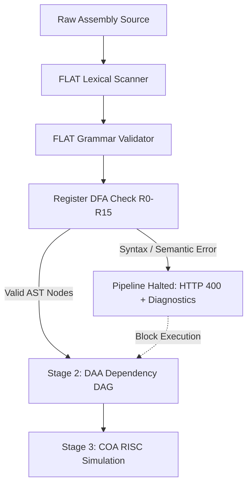

# Micro Project Report: Formal Languages & Automata Theory (FLAT)

---

## Academic Project Information

| Field | Detail |
| :--- | :--- |
| **Project Title** | **AssemblyFlow: Automated Assembly Code Normalizer & Pipelined Execution Analyzer** |
| **Subject** | **Formal Languages and Automata Theory (FLAT)** |
| **Student Name** | **Ashik Ameen** |
| **GitHub Repository** | [https://github.com/Ashik9500/Micro_project.git](https://github.com/Ashik9500/Micro_project.git) |
| **Deployed Web Application** | [https://micro-project-a338.onrender.com/](https://micro-project-a338.onrender.com/) |
| **Technology Stack** | TypeScript, Node.js, Express, React 19, Vite |
| **Submission Date** | October 2026 |

---

## 1. Executive Summary & Abstract

**AssemblyFlow** is an integrated computer science engineering workbench developed to bridge the theoretical foundations of compiler front-ends with computer architecture simulations. Within this multi-disciplinary project, the **Formal Languages and Automata Theory (FLAT)** module acts as **Stage 1 (The Compiler Front-End)**, responsible for scanning, tokenizing, and mathematically validating raw assembly source text.

Before instruction dependency analysis (DAA) or cycle-accurate pipeline simulation (COA) can occur, raw textual source code must be converted into a structured, unambiguous Abstract Syntax Tree (AST). The FLAT engine implements:
1. An $\mathcal{O}(N)$ deterministic lexical scanner that breaks character streams into atomic tokens.
2. A formal **Deterministic Finite Automaton (DFA)** $M = (Q, \Sigma, \delta, q_0, F)$ recognizing the regular language of valid register tokens $L = \{R0, R1, \dots, R15\}$.
3. A **Context-Free Grammar (CFG)** validator enforcing strict production rules for instruction forms (`LOAD`, `MOV`, `ADD`, `SUB`), register boundaries, immediate numerical literals, and comma delimiters.
4. An immediate **Safety Halt Invariant**: If any lexical or syntactic violation is encountered, the execution pipeline halts immediately with line and column diagnostics, preventing corrupted or malformed data from reaching downstream stages.

---

## 2. Theoretical Foundations in FLAT

### 2.1 The Chomsky Hierarchy & Language Classification
In computer science, formal languages are classified under the Chomsky hierarchy:
- **Type 3 (Regular Languages)**: Recognized by Finite State Automata (DFA/NFA) and specified by Regular Expressions. In AssemblyFlow, register identifiers ($R0$–$R15$), integer literals, and punctuation symbols belong to Type 3 languages.
- **Type 2 (Context-Free Languages)**: Recognized by Pushdown Automata and specified by Context-Free Grammars (CFG). Assembly language instruction statements with matching delimiters and structured argument lists are evaluated against CFG production rules.

### 2.2 Formal 5-Tuple Definition of the Register Token DFA
A Deterministic Finite Automaton (DFA) is formally denoted by the 5-tuple:
$$M = (Q, \Sigma, \delta, q_0, F)$$

Where:
1. **$Q$ is the finite set of states**:
   $$Q = \{q_0, q_1, q_2, q_3, q_4, q_5, q_{\text{trap}}\}$$
   - $q_0$: Start state (initial empty input state).
   - $q_1$: Prefix state (encountered valid prefix `'R'` or `'r'`).
   - $q_2$: Accepted single-digit zero state ($R0$).
   - $q_3$: Accepted single-digit one state ($R1$), also serving as the intermediate tens-prefix for registers $R10$–$R15$.
   - $q_4$: Accepted single-digit states ($R2, R3, \dots, R9$).
   - $q_5$: Accepted two-digit states ($R10, R11, R12, R13, R14, R15$).
   - $q_{\text{trap}}$: Dead / Trap state (unrecoverable rejection state).

2. **$\Sigma$ is the input alphabet**:
   $$\Sigma = \{R, r, 0, 1, 2, 3, 4, 5, 6, 7, 8, 9, \text{other}\}$$

3. **$q_0 \in Q$ is the designated initial state**: $q_0$.

4. **$F \subseteq Q$ is the set of final (accepting) states**:
   $$F = \{q_2, q_3, q_4, q_5\}$$

5. **$\delta: Q \times \Sigma \rightarrow Q$ is the transition function**, defined by the state transition table below:

| Current State $q$ | Input Symbol $a$ | Next State $\delta(q, a)$ | Description / Production Meaning |
| :--- | :--- | :--- | :--- |
| **$q_0$** | `'R'`, `'r'` | **$q_1$** | Valid register prefix matched |
| **$q_0$** | Any other character | **$q_{\text{trap}}$** | Invalid prefix (e.g., `'X'`, `'1'`) |
| **$q_1$** | `'0'` | **$q_2$** *(Accepting)* | Matches register `R0` |
| **$q_1$** | `'1'` | **$q_3$** *(Accepting)* | Matches `R1` or begins `R10`–`R15` |
| **$q_1$** | `'2'` – `'9'` | **$q_4$** *(Accepting)* | Matches single-digit registers `R2`–`R9` |
| **$q_1$** | Any other character | **$q_{\text{trap}}$** | Missing digit or non-numeric symbol |
| **$q_2$** | Any character | **$q_{\text{trap}}$** | Trailing characters after `R0` (e.g. `R01`, `R0A`) |
| **$q_3$** | `'0'` – `'5'` | **$q_5$** *(Accepting)* | Matches two-digit registers `R10`–`R15` |
| **$q_3$** | `'6'` – `'9'` | **$q_{\text{trap}}$** | Out of bounds: `R16`–`R19` exceed 16-register limit |
| **$q_3$** | Any other character | **$q_{\text{trap}}$** | Non-numeric trailing character |
| **$q_4$** | Any character | **$q_{\text{trap}}$** | Out of bounds: 2-digit starting with 2–9 (e.g. `R20`) |
| **$q_5$** | Any character | **$q_{\text{trap}}$** | Trailing characters after valid 2-digit register |
| **$q_{\text{trap}}$** | Any character | **$q_{\text{trap}}$** | Dead state loops indefinitely |

### 2.3 Formal Grammar Specification (EBNF)
The assembly grammar accepted by AssemblyFlow is formally defined in Extended Backus-Naur Form (EBNF):

```ebnf
Program         ::= ( Line "\n" )* Line ?
Line            ::= [ Whitespace ] [ Statement ] [ Comment ]
Statement       ::= LoadInstruction | MovInstruction | AddInstruction | SubInstruction
Comment         ::= ";" [ AnyCharacterExceptNewline ]*

LoadInstruction ::= "LOAD" Whitespace Register Whitespace "," Whitespace Integer
MovInstruction  ::= "MOV"  Whitespace Register Whitespace "," Whitespace Register
AddInstruction  ::= "ADD"  Whitespace Register Whitespace "," Whitespace Register Whitespace "," Whitespace Register
SubInstruction  ::= "SUB"  Whitespace Register Whitespace "," Whitespace Register Whitespace "," Whitespace Register

Register        ::= ("R" | "r") Digit15
Digit15         ::= "0" | "1" | ... | "15"
Integer         ::= [ "+" | "-" ] Digit+
Digit           ::= "0" | "1" | "2" | "3" | "4" | "5" | "6" | "7" | "8" | "9"
```

---

## 3. System Architecture & Implementation in AssemblyFlow

The FLAT module is located within `assemblyflow/backend/src/services/flat/` and exposed via REST endpoints in `assemblyflow/backend/src/routes/flat.ts`.

### 3.1 Lexical Scanner (`tokenizer.ts`)
The scanner performs linear character scanning ($\mathcal{O}(N)$) while maintaining a strict 1-indexed column count for developer feedback.

```typescript
// Categorized Token Representation
export type TokenType = 'OPCODE' | 'REGISTER' | 'INTEGER' | 'COMMA' | 'COMMENT' | 'INVALID';

export interface Token {
  type: TokenType;
  value: string;
  line: number;
  column: number;
}
```

The tokenizer classifies characters into tokens using unambiguous lookahead:
1. Whitespaces (`' '`, `'\t'`, `'\r'`) increment column counters and are discarded.
2. Semicolons (`';'`) capture trailing comments to end-of-line.
3. Commas (`','`) emit `COMMA` tokens.
4. Leading digits or signed characters (`'+'`, `'-'`) scan integer literals. If followed by letters (e.g., `100abc`), the token is tagged as `INVALID`.
5. Alphabetic identifiers are normalized to uppercase and checked against the opcode symbol set:
   $$\text{SUPPORTED\_OPCODES} = \{\text{LOAD}, \text{MOV}, \text{ADD}, \text{SUB}\}$$
6. Remaining alphanumeric strings are tested against regular pattern `/^[Rr][0-9]+$/` and assigned `REGISTER` or `INVALID`.

### 3.2 Register DFA Simulator (`dfa.ts`)
The formal DFA transition function is implemented in `dfa.ts` with explicit step tracing:

```typescript
export function simulateRegisterDFA(input: string): DFATraceResult {
  const acceptingSet = new Set(REGISTER_DFA_DEFINITION.acceptingStates);
  let currentState = REGISTER_DFA_DEFINITION.startState;
  const path: string[] = [currentState];
  const steps: DFAStep[] = [];

  for (let i = 0; i < input.length; i++) {
    const char = input[i];
    const { nextState, note } = transition(currentState, char);
    steps.push({
      step: i + 1,
      inputChar: char,
      fromState: currentState,
      toState: nextState,
      isAccepting: acceptingSet.has(nextState),
      note,
    });
    currentState = nextState;
    path.push(currentState);
  }

  return {
    input,
    isAccepted: acceptingSet.has(currentState),
    finalState: currentState,
    path,
    steps,
    explanation: ...
  };
}
```

### 3.3 Grammar Validator (`validator.ts`)
The validator evaluates lines against instruction-specific production rules:
- Verifies exact operand count (e.g., `LOAD` expects 2, `ADD` expects 3).
- Ensures commas strictly delimit registers and integers.
- Confirms register indices lie strictly within $0 \le \text{regIndex} \le 15$.
- Constructs the verified Abstract Syntax Tree (AST) node for valid instructions:
  $$\text{InstructionAST} = \{ \text{opcode}: \text{string}, \text{destination}: \text{string}, \text{operands}: (\text{string} \mid \text{number})[] \}$$

---

## 4. Safety Invariants & Cross-Stage Pipeline Halting

A core architectural principle in AssemblyFlow is **Stage-Level Error Halting**:



If any line contains:
- An unknown opcode (e.g., `MUL R1, R2`),
- An out-of-range register (e.g., `MOV R16, R1`),
- A missing delimiter (e.g., `ADD R1 R2`),
- Or an invalid character (e.g., `LOAD R1, $10`),

The server responds with `HTTP 400 Bad Request` and halts the pipeline immediately. This guarantees that DAA dependency analysis and COA pipeline simulation never operate on invalid or corrupt instruction streams.

---

## 5. Experimental Test Cases & Verification

The FLAT module was thoroughly tested through automated unit and integration suites (`flat.test.ts` and `step7_comprehensive.test.ts`).

### Test Case 1: Acceptance of Boundary Registers
- **Input**: `"R0"`, `"R1"`, `"R15"`
- **Trace for `"R15"`**:
  1. $q_0 \xrightarrow{\text{'R'}} q_1$ (Prefix recognized)
  2. $q_1 \xrightarrow{\text{'1'}} q_3$ (Digit 1 read; candidate for $R1$ or $R10$–$R15$)
  3. $q_3 \xrightarrow{\text{'5'}} q_5$ (Second digit 5 read; accepted state)
- **Result**: `isAccepted: true`, Final State: `q5`.

### Test Case 2: Rejection of Out-of-Bounds Register
- **Input**: `"R16"`
- **Trace for `"R16"`**:
  1. $q_0 \xrightarrow{\text{'R'}} q_1$
  2. $q_1 \xrightarrow{\text{'1'}} q_3$
  3. $q_3 \xrightarrow{\text{'6'}} q_{\text{trap}}$ (Exceeds hardware register boundary $R15$)
- **Result**: `isAccepted: false`, Final State: `q_trap`.

### Test Case 3: Rejection of Invalid Prefix
- **Input**: `"X1"`
- **Trace for `"X1"`**:
  1. $q_0 \xrightarrow{\text{'X'}} q_{\text{trap}}$ (Violates register prefix requirement)
- **Result**: `isAccepted: false`, Final State: `q_trap`.

### Test Case 4: Full Program Grammar Validation
- **Input Program**:
  ```assembly
  LOAD R1, 100
  MOV R2, R1
  ADD R3, R1, R2
  SUB R4, R3, R1
  ```
- **Validation Outcome**:
  - Total Lines: 4, Instruction Count: 4, Valid Count: 4, Error Count: 0.
  - Correct AST emitted for each line:
    - Line 1: `{ opcode: 'LOAD', destination: 'R1', operands: [100] }`
    - Line 2: `{ opcode: 'MOV', destination: 'R2', operands: ['R1'] }`
    - Line 3: `{ opcode: 'ADD', destination: 'R3', operands: ['R1', 'R2'] }`
    - Line 4: `{ opcode: 'SUB', destination: 'R4', operands: ['R3', 'R1'] }`

---

## 6. Frontend Interactive Visualizations

The React frontend (`FlatModuleView.tsx`) provides interactive educational tools:
1. **Line-by-Line Token Inspector**: Displays color-coded token badges (`OPCODE`, `REGISTER`, `INTEGER`, `COMMA`, `COMMENT`, `INVALID`) alongside AST parse outputs.
2. **Interactive DFA Workbench**: Allows users to enter arbitrary token candidates (e.g., `R5`, `R14`, `R16`, `R25`, `X1`) and observe the step-by-step state transition table and graphical state path.
3. **Formal State Machine Transition Reference**: Full display of the formal transition table $\delta(q, a)$.

---

## 7. Asymptotic Complexity Analysis

| Operation | Input Parameter | Time Complexity | Space Complexity | Description |
| :--- | :--- | :--- | :--- | :--- |
| **Line Tokenization** | $L$ (characters per line) | $\mathcal{O}(L)$ | $\mathcal{O}(T)$ | Single left-to-right pass across characters |
| **Program Tokenization**| $N$ (total source characters) | $\mathcal{O}(N)$ | $\mathcal{O}(T)$ | Linear scaling with source file size |
| **Register DFA Trace** | $K$ (token length $\le 4$) | $\mathcal{O}(K) = \mathcal{O}(1)$ | $\mathcal{O}(K) = \mathcal{O}(1)$ | Deterministic single state lookup per character |
| **Grammar Validation** | $T$ (tokens per line $\le 6$) | $\mathcal{O}(T) = \mathcal{O}(1)$ | $\mathcal{O}(1)$ | Fixed lookahead validation per instruction |
| **Total Pipeline Stage 1** | $N$ (total code characters) | $\mathcal{O}(N)$ | $\mathcal{O}(N)$ | Optimal linear time complexity |

---

## 8. Conclusion & Learning Outcomes

By implementing the FLAT module in AssemblyFlow:
1. Demonstrated the practical application of **Deterministic Finite Automata** for lexical token classification and hardware constraint enforcement ($R0$–$R15$).
2. Applied **Context-Free Grammar production rules** to parse and validate structured assembly instructions into an Abstract Syntax Tree.
3. Engineered a production-grade compiler front-end with descriptive column-accurate error diagnostics and fail-safe halting mechanisms.

---

## 9. Academic References

1. **Hopcroft, J. E., Motwani, R., & Ullman, J. D.** (2006). *Introduction to Automata Theory, Languages, and Computation* (3rd ed.). Pearson / Addison-Wesley.
2. **Aho, A. V., Lam, M. S., Sethi, R., & Ullman, J. D.** (2006). *Compilers: Principles, Techniques, and Tools* (2nd ed.). Addison-Wesley.
3. **Sipser, M.** (2012). *Introduction to the Theory of Computation* (3rd ed.). Cengage Learning.
